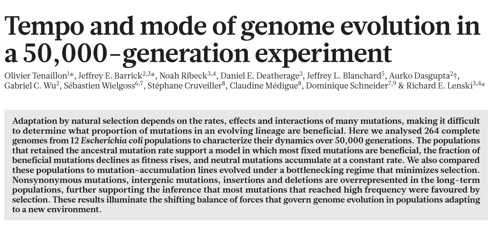
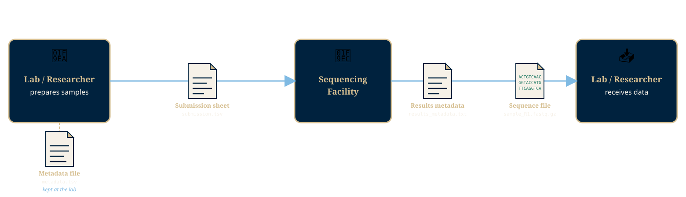

## {.custom-title background-color="#00223e"}

::: {.ct-series}
GW Libraries & Academic Innovation · Hands-on Workshop
:::

::: {.ct-title}
The Data Exorcist
:::

::: {.ct-subtitle}
Turning Metadata Nightmares into Tidy Data
:::

::: {.ct-author}
Dan Kerchner · George Washington University Libraries & Academic Innovation
:::

---

## Learning Objectives

By the end of this workshop you will be able to:

- Identify the types of metadata a sequencing experiment produces
- Recognize the importance of consistent, documented metadata
- Spot common spreadsheet formatting problems that cause downstream pain
- Apply best practices to structure data for both humans and computers

---

## You and Your Data

- What kind of raw data are you collecting?
- Besides you, who will be working with your data?
- What question will you be answering by analyzing this data?

*It's okay if you don't know yet!!*

---

## Today's Data Set

Tenaillon O, Barrick JE, Ribeck N, Deatherage DE, Blanchard JL, Dasgupta A, Wu GC, Wielgoss S, Cruveiller S, Médigue C, Schneider D, Lenski RE. Tempo and mode of genome evolution in a 50,000-generation experiment (2016) Nature. 536(7615): 165–170. [10.1038/nature18959](https://doi.org/10.1038/nature18959)

More info at [datacarpentry.org/organization-genomics/data](https://datacarpentry.org/organization-genomics/data)

---

## The Sample Submission Workflow

{fig-alt="Workflow diagram: Lab prepares samples, keeps its own metadata file, and sends only a sample submission sheet to the Sequencing Facility, which returns a results metadata file and sequence files back to the Lab."}

- Kept **at** the lab (not sent): metadata file (`metadata.tsv`)
- Sent **to** the facility: [sample submission sheet](https://raw.githubusercontent.com/datacarpentry/wrangling-genomics/gh-pages/files/Ecoli_metadata_composite.tsv)
- Received **back** from the facility: [results metadata file](https://gwu-libraries.github.io/organization-genomics/files/sequencing_results_metadata.txt) + sequence files (`.fastq.gz`)

---

## Types of Files We'll Be Using

- Spreadsheet data from the experiment that tracks the strains and their phenotype over time
- Spreadsheet data with information on the samples that were sequenced
  - The names of the samples
  - How they were prepared
  - Sequencing conditions
- The sequence data returned from the sequencing lab

---

## Why Are We Learning This?

More organized/clean data == easier analysis/data wrangling by code and/or humans

---

## Example Metadata

Messy version (XLSX): [go.gwu.edu/ecolimessy](https://go.gwu.edu/ecolimessy)

::: {.tip-box}
**Discussion** (with the person next to you):

What are some of the problems with this spreadsheet?

1. What is the issue?
2. Why does it matter computationally?
3. How would you fix it?
:::

---

## Example Metadata

Cleaner version (TSV): [go.gwu.edu/ecoliclean](https://go.gwu.edu/ecoliclean)

---

## Messy vs. Tidy: A Side-by-Side {.smaller}

::: {.compare-cols}

::: {.compare-bad}
**Messy**

- Two separate data tables on one sheet
- Column names with spaces (`sample date`)
- Colors encode meaning (no column captures it)
- Species + strain combined in one cell (`E. coli K-12`)
- Inconsistent column names across rows
:::

::: {.compare-good}
**Tidy**

- One table per sheet / file
- Column names: `sample_date`
- Encode everything in text columns
- Separate columns: `genus`, `species`, `strain`
- Consistent names throughout
:::

:::

---

## Structuring Data in Spreadsheets

- Leave the raw data raw - do not change it!
- Put each observation or sample in its own row
- Put all your variables in columns - data that vary between samples
- Use column names that are explanatory, but without spaces. Use `_` or CamelCase instead of a space. For instance `sequencing_depth` or `SeqDepth` is better than `Sequencing Depth`, because computers interpret spaces in particular ways
- Don't combine multiple pieces of information in one cell.
  Example - instead of this: `species_strain = "E. coli K12"`
  try this: `species = "E. coli", strain = "K12"`
  Another example - consider separating genus and species (it depends)
- Export the cleaned data to a **text-based format** like CSV (comma-separated values) or TSV (tab-separated values). This ensures that anyone can use the data, and is required by most data repositories

---

## More Spreadsheet Bloopers

- Don't put multiple tables in one sheet
- Be wary of using multiple tabs/worksheets
- Record zeros (unless they are actually missing)
- How are you representing null/missing values? What could be the problem with: `0` / Blank / `-999` / `NA` / `N/A` / `NULL` / `None` / `-` / `.`
- Don't use formatting to convey information (consider encoding this info)
- Don't merge cells!
- Avoid using special characters in data (and especially in column names)

---

## What Is Metadata?

**Metadata** = data *about* your data

::: {.tip-box}
Without metadata describing what was sequenced, your sequences are **meaningless** — just strings of letters with no scientific context.
:::

Metadata in a genomics project includes:

- Experimental spreadsheets and sample sheets
- Lab notebook entries (wet lab procedures, dates, protocols)
- Sample preparation and sequencing parameters
- Links between sample IDs and resulting files

--- 

## Why Metadata Standards Exist

Several organizations maintain field-specific metadata standards.  The **Digital Curation Center** maintains a list of research metadata standards: [www.dcc.ac.uk/guidance/standards/metadata/list](https://www.dcc.ac.uk/guidance/standards/metadata/list)

::: {.gold-box}
**No standard for your situation?**
Ask: *"What is the minimum information someone would need to work with my data — without talking to me?"*
:::

---

## Problems in Metadata

Download and open the text file at [go.gwu.edu/seqsubmit](https://go.gwu.edu/seqsubmit)

- What are some errors you can spot in the data? Typos, missing data, inconsistencies?
- What improvements could be made to the choices in variable naming?
- What are some errors in the spreadsheet that would be difficult to spot? Is there any way you can test for these types of errors?

---

## Metadata - Sequencing Data Received Back

Download the sequencing data received back

- As text: [go.gwu.edu/seqdata](https://go.gwu.edu/seqdata)
- As Excel: [go.gwu.edu/seqexcel](https://go.gwu.edu/seqexcel)

- How are these samples organized?
- If you wanted to associate the sequence file names with their corresponding sample names from the submission sheet, could you do so? How?
- What do the `_R1` and `_R2` extensions mean in the file names?
- What does the `.gz` extension on the filenames indicate?
- What is the total file size of the sequence files referenced in the metadata - what challenges in downloading and sharing these data might exist?

---

## Storing Data

Store the data

- Accessible by you and other members of your lab
- Leave the raw data raw. Take measures to avoid accidentally modifying raw data
- Redundant backups - 2 locations in different regions

Solutions include

- On-campus data storage
- Hard drives
- Cloud storage (Amazon S3, MS Azure, Google Cloud, etc.)
- OSF (Open Science Framework) - files < 5 GB

---

## Anatomy of a Research Spreadsheet

A well-formed spreadsheet has a simple structure:

| | column (variable) | column (variable) |
|---|---|---|
| **row (observation)** | value | value |
| **row (observation)** | value | value |

One row = one sample. One column = one measured attribute.

---

## Summary: Six Rules

1. **Preserve raw data** — never modify the original; work from copies
2. **One observation per row** — each sample gets exactly one row
3. **Variables in columns** — measured attributes live across columns
4. **Clear column names** — no spaces; use `snake_case`, `kebab-case`, or `camelCase`
5. **Atomic data** — one piece of information per cell; split combined values into separate columns
6. **Export as plain text** — use CSV for universal, long-term accessibility

---

## Key Takeaway

::: {.gold-box}
"Organizing your data properly at this point of your experiment will help your analysis later" — and will make data deposition, journal submission, and collaboration much smoother.
:::

Tools for cleaning existing messy data:

- **OpenRefine** — powerful, visual data cleaning
- **Data Carpentry spreadsheet lesson** — detailed guide to common formatting mistakes

---

## Exercise: Diagnosing a Submission Sheet {.smaller}

::: {.tip-box}
**Your turn.** Review the example sample submission sheet.
Find and categorize the issues you see:

| Category | Examples you found |
|---|---|
| Naming inconsistencies | |
| Missing/ambiguous data | |
| Formatting problems | |
| Other | |
:::

*~10 minutes, then group discussion*

---

## What Comes Back from the Facility

The facility returns two things:

1. **Metadata documentation** — updated sample sheet linking IDs to files
2. **Sequence files** — raw reads in compressed FASTQ format

::: {.smaller}
| File name pattern | What it means |
|---|---|
| `SampleID_R1.fastq.gz` | Read 1 (forward read) |
| `SampleID_R2.fastq.gz` | Read 2 (reverse read, paired-end) |
| `.gz` extension | gzip-compressed to reduce disk space |
:::

Your **sample IDs** are the link between submission sheet and returned files — they must match exactly.

---

## Three Laws of Raw Data Storage

::: {.gold-box}
1. **Never modify raw data** — all analysis uses copies
2. **Redundant backups** in physically separate locations
3. **Accessible** to lab members and leadership (not just the person who generated it)
:::

Storage options to consider:

- Institutional HPC / research computing storage
- External hard drives (offline backup)
- Cloud: Amazon S3, Microsoft Azure, Google Cloud, Open Science Framework

---

## Key Takeaway

::: {.gold-box}
**Planning, documenting, and organizing** are not overhead — they *are* the science.
Errors introduced at the data collection and storage stage propagate through every downstream analysis.
:::

The metadata you document now is the metadata future-you (and your collaborators, and reviewers) will need.

---

## The Exorcism Toolkit

A summary of what we've covered:

| Problem | Tool / Practice |
|---|---|
| Messy spreadsheet | Tidy data rules + tools such as OpenRefine |
| No metadata standard | "Minimum info needed" heuristic |
| Ambiguous file names | Consistent, atomic naming conventions |
| Lost or corrupted raw data | 3-location backup strategy |
| Unreproducible analysis | Document everything; preserve originals |

---

## Resources

- **Data Carpentry — Genomics Organization lesson**
  [datacarpentry.github.io/organization-genomics](https://datacarpentry.github.io/organization-genomics/)
- **Data Carpentry — Spreadsheet Ecology lesson** (detailed formatting mistakes)
  [datacarpentry.github.io/spreadsheet-ecology-lesson](https://datacarpentry.github.io/spreadsheet-ecology-lesson/)
- **OpenRefine**
  [openrefine.org](https://openrefine.org)

---

## Thanks! 🔮

**Dan Kerchner** | George Washington University Libraries
[kerchner@gwu.edu](mailto:kerchner@gwu.edu)

Stats & Coding help @ GW:

|  |  |   |
|---|---|----------------|
| me | **AI**, R, Python | [calendly.com/kerchner](https://calendly.com/kerchner) |
| Academic Commons Data Consultants | R, Statistics, Python, SAS, Excel | [go.gwu.edu/DataConsulting](https://go.gwu.edu/DataConsulting) |
| LAI Software Developers | Python, web apps, HTML | [calendly.com/gwul-coding](https://calendly.com/gwul-coding) |

: {tbl-colwidths="[28,37,35]"}

These slides: [kerchner.github.io/data-exorcism](https://kerchner.github.io/data-exorcism)
Code: [github.com/kerchner/data-exorcism](https://github.com/kerchner/data-exorcism)
